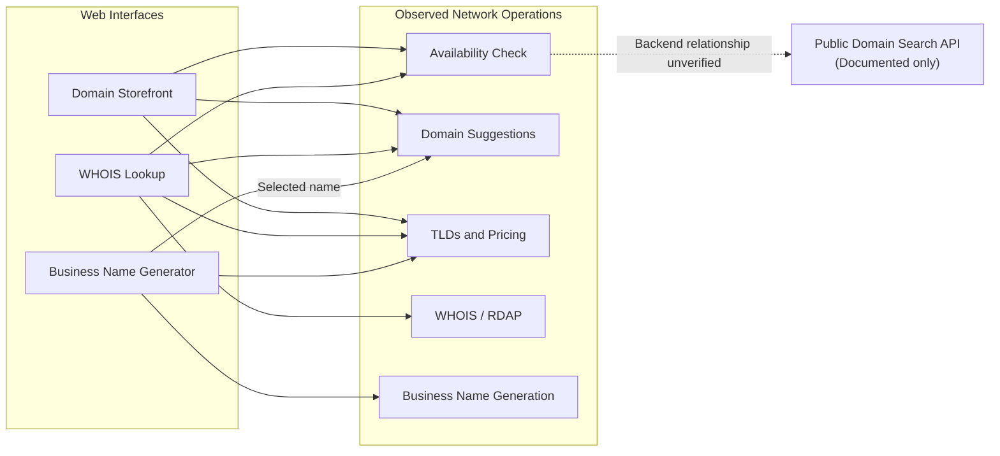
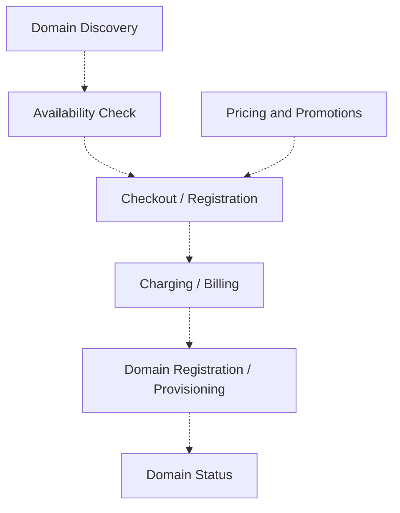

# Wix Domains – Architecture Overview (QA Assignment)

## 1. Scope and Evidence Methodology

This document maps four Wix Domains surfaces from a QA perspective within a strict 3-hour assignment budget.

It covers observed UI behavior, network interactions, documented public APIs, and the inferred business flow from domain discovery to payment and registration.

No real purchase, payment, or domain registration was performed. Credentials, API keys, sensitive headers, and pagination cursor values are intentionally excluded.

### Evidence Classification

| Label | Meaning |
|---|---|
| **Observed** | Verified directly in the UI or browser DevTools during exploration. |
| **Documented** | Described in official Wix documentation but not executed. |
| **Inferred** | A logical business or technical dependency requiring verification. |

HTTP 200 confirms a successful HTTP response, not necessarily correct business behavior.

## 2. Four-Door Overview

| Surface | URL | Evidence |
|---|---|---|
| Domain Storefront | https://www.wix.com/domains | Observed |
| WHOIS Lookup | https://www.wix.com/domains/whois | Observed |
| Business Name Generator | https://www.wix.com/tools/business-name-generator | Observed |
| Public Domain Search API | https://dev.wix.com/docs/api-reference/account-level/domains/domain-search/availability-v2/check-domain-availability | Documented |

The three web interfaces provide different entry points into domain discovery.

The public API provides a documented integration interface. Its relationship to the internal web endpoints has not been verified.

## 3. UI-to-Network Mapping

### 3.1 Domain Storefront (Observed)

**Input:** `lotus-music.com`

The UI displayed the domain as registered.

Observed network calls:

| Operation | Result | UI responsibility |
|---|---|---|
| `check-domain-availability` | 200 | Domain availability |
| `suggest-domains` | 200 | Alternative domain suggestions |
| `list-tlds` | 200 | Supported TLD options |
| `suggested-tld-display-prices` | 200 | Domain price presentation |
| `tld-promotions` | 200 | Promotional information |
| `keywords` | 200 | Search-related keyword suggestions |

The availability response contained:

- `availability.domain = lotus-music.com`
- `availability.available = false`
- `availability.premium = false`

This matched the UI's registered status.

`suggest-domains` returned 50 suggestions with cursor-based pagination and `hasNext = true`.

**QA concern:** Suggestions, availability, and pricing are separate responsibilities. A suggested domain should not be assumed available or purchasable without verification.

### 3.2 WHOIS Lookup (Observed)

**Input:** `lotus-music.com`

The UI displayed:

- Domain creation and expiration dates
- Registrar
- Nameservers
- Domain status
- Redacted registrant contact information

Observed HTTP 200 operations:

- `rdap-url`
- WHOIS domain fetch
- `parse-rdap`
- `whois?domain=lotus-music.com`
- `check-domain-availability`
- `suggest-domains`
- `list-tlds`
- `suggested-tld-display-prices`

**QA concern:** RDAP-related calls suggest a registration-data dependency. The underlying source, caching, and freshness guarantees remain unverified.

Redacted registrant details are not classified as a defect without evidence of incorrect behavior.

### 3.3 Business Name Generator (Observed)

**Input:**

"An online music store selling guitars, musical instruments, and accessories for beginner and professional musicians."

The `generate` request returned HTTP 200.

Generated names included:

- Harmonix
- Chordify
- Vibrant Strings

Selecting Harmonix led to domain suggestions, including:

- `harmonixsoundworks.com`
- `harmonix.studio`

Supporting operations:

- `suggest-domains`
- `suggested-tld-display-prices`
- `list-tlds`

The UI displayed a free-for-one-year domain offer conditional on an annual website plan.

**QA concern:** Generated names may vary. Automated tests should validate output structure and business-name-to-domain handoff instead of relying on exact generated names.

The internal generation implementation and any underlying AI model were not verified.

### 3.4 Public Domain Search API (Documented)

Official documentation:

https://dev.wix.com/docs/api-reference/account-level/domains/domain-search/availability-v2/check-domain-availability

Documented endpoint:

`GET https://www.wixapis.com/domain-search/v2/check-domain-availability`

- Requires an account-level API key.
- Accepts a domain name including its TLD.
- Returns domain availability information.
- Public API execution has not yet been verified.
- Request parameters and authentication headers must be verified against the official API contract before implementation.

**QA concern:** The public API should be validated independently and compared with web UI behavior for the same domains where practical.

No shared backend relationship has been established.

## 4. Architecture Diagrams

### 4.1 Observed Domain Discovery Architecture

The diagram groups observed network operations by responsibility.

Solid arrows represent observed UI-to-network interactions. The dashed arrow represents an unverified relationship.

Network operation nodes are logical groupings of observed calls, not verified backend services.

### 4.2 Domain Purchase, Charging and Registration Flow

The following is a conceptual business flow, **not an observed internal architecture**.

The public Wix documentation describes availability checking, package/product-instance creation, and registration. Charging, payment processing, and provisioning are included here as inferred business responsibilities.

All arrows in this diagram are conceptual and unverified.

The actual sequence, transaction boundaries, payment provider, asynchronous processing, and failure-recovery mechanisms are unknown.

**Important business invariant:** A successful payment must not leave the customer permanently charged without the corresponding domain entitlement or an appropriate recovery/refund process.

## 5. Integration Points and Dependencies

| Integration | Evidence | QA relevance |
|---|---|---|
| Storefront ↔ WHOIS availability | Observed | Availability consistency across surfaces |
| Domain suggestions across three web interfaces | Observed | Suggestion structure, relevance, pagination |
| TLD and pricing operations | Observed | Supported TLDs, currency and price consistency |
| Business name → domain suggestions | Observed | Selected-name handoff |
| WHOIS / RDAP operations | Observed | Registration metadata and redaction |
| Public API authentication | Documented | Secure account-level API access |
| Public API ↔ internal availability | Inferred | Cross-interface contract consistency |
| Pricing → Checkout | Inferred | Final amount must match applicable price, tax and promotion rules |
| Checkout → Charging / Billing | Inferred | Payment correctness, retries and idempotency |
| Charging ↔ Domain Registration | Inferred | Payment and registration outcome consistency |
| Registration → Domain Status | Inferred | Accurate ownership and lifecycle state |

### Charging and Registration Risks

The most business-critical risks are:

1. **Duplicate charge:** A retry or timeout results in multiple charges for one intended purchase.
2. **Payment-registration mismatch:** Payment succeeds but domain registration fails or remains unresolved.
3. **Duplicate registration:** A domain already registered becomes purchasable again because of stale availability data.
4. **Incorrect pricing:** The charged amount differs from the applicable checkout price, including currency, taxes, promotions, and premium-domain rules.
5. **Renewal mismatch:** Renewal pricing or billing differs from the applicable renewal terms.

These are risk hypotheses, not confirmed defects.

They require controlled test environments, payment-provider simulation, and backend reconciliation to validate fully.

## 6. Unknowns and Follow-Up Verification

| Unknown | Proposed verification |
|---|---|
| Does the public API agree with Storefront availability? | Compare the same domains within a short time window. |
| Are suggested domains actually available? | Independently validate a sample of suggestions. |
| Are prices consistent across surfaces? | Compare TLD, currency, registration term and promotion eligibility. |
| Does suggestion pagination work correctly? | Validate cursor progression, duplicates and termination. |
| How does WHOIS handle invalid or unregistered domains? | Test negative and boundary inputs. |
| How robust is business name generation? | Test multilingual, empty, long and unusual descriptions. |
| How is charging protected against duplicate requests? | Verify idempotency and payment-provider retry handling in a controlled environment. |
| What happens if payment succeeds but registration fails? | Validate reconciliation, recovery and refund workflows. |
| Can a domain be purchased twice during concurrent requests? | Verify registration uniqueness and race-condition handling in a non-production environment. |
| How are payment and domain status reconciled? | Validate database records, transaction events and provider status where access is available. |
| What is the relationship between web endpoints and the public API? | Review internal architecture or consult service owners. |

## 7. Scope Limitations

The following were deliberately not executed:

- Domain purchase or registration
- Real payment or charging
- Checkout completion
- Renewal and transfer operations
- Authenticated account-management flows
- Load, stress or brute-force testing
- Database and internal service validation
- Public Domain Search API execution (pending automation)

Charging and registration scenarios are documented as **Not Executed**, not Passed or Failed.

Blocked analytics requests and unrelated HTTP 401 responses observed in DevTools are not classified as confirmed defects without additional evidence.

The risk-based testing strategy and execution priorities are detailed in `TEST_PLAN.md`.
